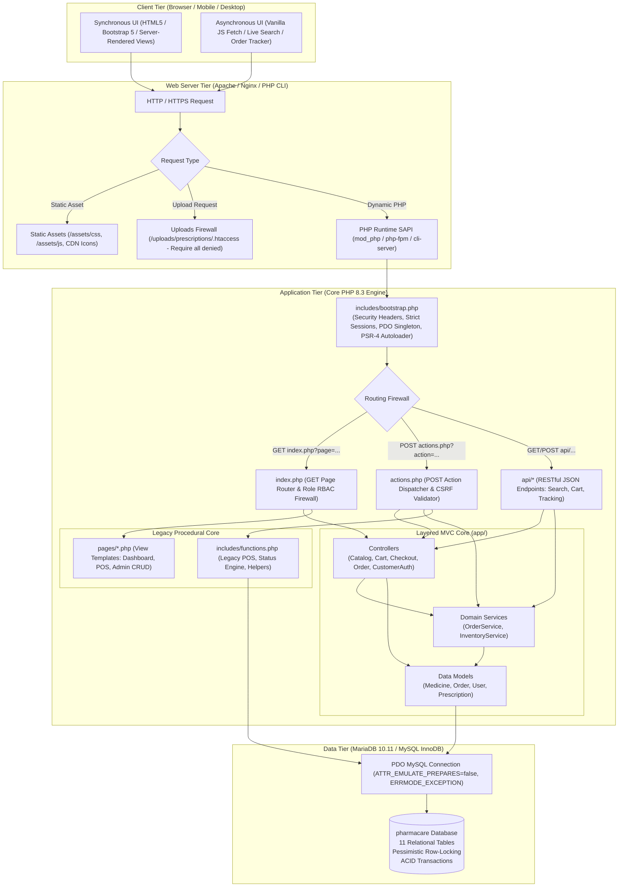
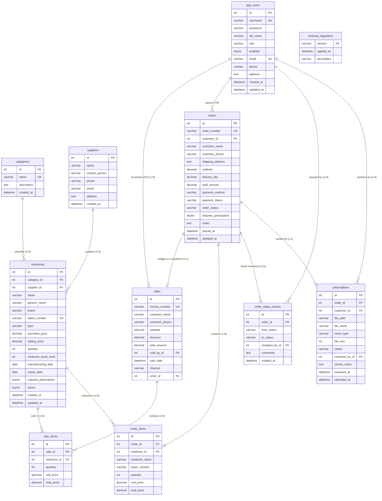
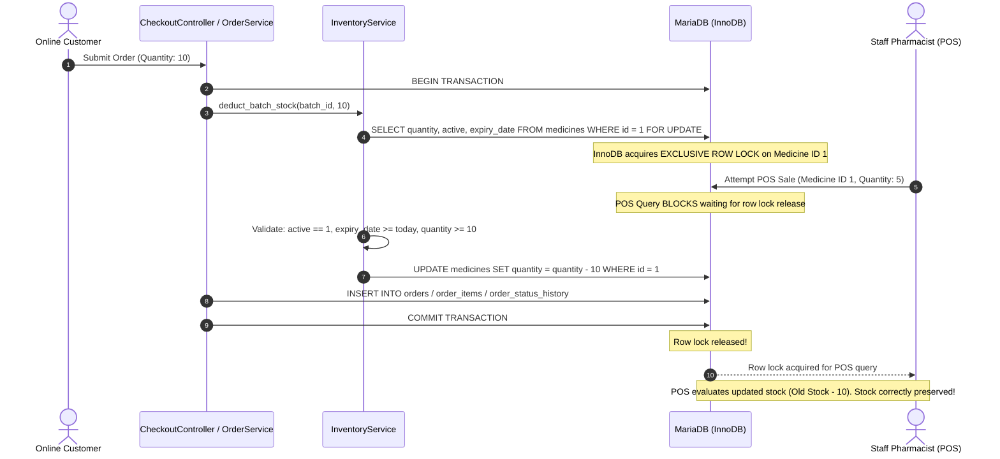

# PharmaCare System Architecture & Technical Specification

**Course:** CIS324 Web Engineering Semester Project (Topic 13: Pharmacy Management System)  
**Authors:** PharmaCare Engineering Team  
**Technology Stack:** Core PHP 8.3, MariaDB 10.11 / MySQL InnoDB, PDO, Bootstrap 5.3.3, Vanilla JavaScript (Fetch API)  
**Architectural Style:** Hybrid Layered MVC (Domain Services & Models) + Procedural Page Controller  

---

## 1. High-Level System Architecture

PharmaCare is engineered as a secure, high-performance web application adhering to the classical **Three-Tier Architectural Model**:
1. **Presentation Tier (Client/Frontend):** Responsive HTML5, Bootstrap 5.3.3, Bootstrap Icons, and Vanilla JavaScript (Fetch API). Renders views, captures user actions, and performs asynchronous DOM updates without full page reloads.
2. **Application Tier (Server/Backend):** Core PHP 8.3 runtime operating behind a Web Server (Apache, Nginx, or PHP CLI Server). Organizes application logic through a front controller routing firewall (`index.php`), transaction handlers (`actions.php`), asynchronous API endpoints (`api/`), PSR-4 autoloader, Layered MVC Controllers (`app/Controllers`), and Domain Services (`app/Services`).
3. **Data Tier (Persistence/Storage):** MariaDB 10.11 / MySQL running the InnoDB storage engine. Enforces referential integrity with foreign key constraints, pessimistic row locking (`SELECT ... FOR UPDATE`), and atomic transactions (ACID guarantees).

### Architectural Flow Diagram



---

## 2. Relational Database Schema & Entity Relationships

The `pharmacare` database consists of **11 relational tables** configured under the **MySQL/MariaDB InnoDB engine** with strict foreign keys, index optimizations, and `utf8mb4_unicode_ci` collation.

### Entity-Relationship (ER) Diagram



### Table Specifications & Referential Constraints

| Table Name | Engine | Rows (Seeded) | Purpose & Constraints | Foreign Key Dependencies |
| :--- | :--- | :--- | :--- | :--- |
| **`app_users`** | InnoDB | 3 | Stores Admin, Staff, and Customer user accounts. Passwords hashed via Bcrypt. Unique constraints on `username` and `email`. | None (Root entity). |
| **`categories`** | InnoDB | 5 | Pharmacological taxonomy (e.g., Antibiotic, Analgesic). Unique index on `name`. | Protected by `ON DELETE RESTRICT` from child medicines. |
| **`suppliers`** | InnoDB | 3 | Pharmaceutical distributors & manufacturers. | Protected by `ON DELETE RESTRICT` from child medicines. |
| **`medicines`** | InnoDB | 120 batches | Inventory batches with expiry, stock level, pricing, and prescription flags. Unique index on `batch_number`. | FK to `categories(id)` (`RESTRICT`), FK to `suppliers(id)` (`RESTRICT`). |
| **`sales`** | InnoDB | 0+ | Unified sales ledger supporting physical POS and completed online orders (`channel` column). Unique index on `invoice_number`. | FK to `app_users(id)` as `sold_by_id` (`RESTRICT`), FK to `orders(id)` as `order_id` (`RESTRICT` on delete, null for POS). |
| **`sale_items`** | InnoDB | 0+ | Line items associated with sales and dispensed medicines. | FK to `sales(id)` (`CASCADE`), FK to `medicines(id)` (`RESTRICT`). |
| **`orders`** | InnoDB | 0+ | Online customer order headers storing status, payment, shipping, and total amounts. Unique index on `order_number`. | FK to `app_users(id)` as `customer_id` (`RESTRICT`). |
| **`order_items`** | InnoDB | 0+ | Line items associated with online orders, capturing point-in-time snapshot of medicine name and batch number. | FK to `orders(id)` (`CASCADE`), FK to `medicines(id)` (`RESTRICT`). |
| **`order_status_history`** | InnoDB | 0+ | Immutable append-only audit trail capturing all lifecycle status transitions with actor ID and comments. | FK to `orders(id)` (`CASCADE`), FK to `app_users(id)` as `changed_by_id` (`RESTRICT`). |
| **`prescriptions`** | InnoDB | 0+ | Uploaded medical prescription files, verification state, and reviewing pharmacist ID. | FK to `orders(id)` (`CASCADE`), FK to `app_users(id)` as `customer_id` (`RESTRICT`), FK to `app_users(id)` as `reviewed_by_id` (`SET NULL`). |
| **`schema_migrations`** | InnoDB | 3 | Database version tracking table (`v1_baseline`, `v2_online_ordering`, `v3_sales_channel_bridge`). Primary key on `version`. | None. |

---

## 3. Shared Inventory Engine & Concurrency Control

In high-volume pharmaceutical dispensaries, inventory consistency is paramount. PharmaCare guarantees that **physical POS billing** and **online customer orders** share a single unified inventory engine ([`app/Services/InventoryService.php`](file:///d:/PharmaCare-PHP-Complete/PharmaCare-PHP/app/Services/InventoryService.php)) backed by MariaDB InnoDB row-level locking.

### Concurrency & Pessimistic Row Locking Protocol

When stock deduction occurs, the application prevents race conditions and overselling using the `SELECT ... FOR UPDATE` query within an isolated transaction boundary:



### ACID Transaction Guarantees

| Property | Implementation in PharmaCare |
| :--- | :--- |
| **Atomicity** | If an order requires 3 different medicines and the third has insufficient stock, the transaction throws a `DomainException`. `$pdo->rollBack()` executes automatically in the `catch` block, restoring all deductions and ensuring no partial orders exist. |
| **Consistency** | Database constraints enforce `quantity >= 0`, foreign keys prevent orphaned line items, and the status priority engine evaluates medicine validity prior to deduction. |
| **Isolation** | MySQL/MariaDB InnoDB default isolation level is `REPEATABLE READ`. By executing `SELECT ... FOR UPDATE`, PharmaCare escalates read locks to write-exclusive locks, preventing phantom reads and non-repeatable reads. |
| **Durability** | Committed transactions write to MariaDB's InnoDB redo log (WAL - Write-Ahead Logging) on disk before acknowledging completion. |

### First Expiry, First Out (FEFO) Stock Allocation

To minimize drug expiration and inventory waste, [`InventoryService::allocate_fefo_stock()`](file:///d:/PharmaCare-PHP-Complete/PharmaCare-PHP/app/Services/InventoryService.php#L69-L115) automatically selects the optimal medicine batches when an order is placed without a pre-pinned batch:
1. Filters for batches where `name = :name` (or `generic_name = :generic`), `active = 1`, `expiry_date >= CURDATE()`, and `quantity > 0`.
2. Orders candidates strictly by `expiry_date ASC, quantity DESC`.
3. Iteratively allocates stock across earliest-expiring batches until requested quantity is fully satisfied.

### Idempotent Cancellation & Stock Restoration

When an order in an active state (`PENDING`, `CONFIRMED`, `PROCESSING`, `READY`) is cancelled by a customer or staff member:
1. The status transition engine verifies that the current status is not already `CANCELLED` or `COMPLETED`.
2. `InventoryService::restore_batch_stock()` iterates through each `order_items` record.
3. Row locks are acquired with `SELECT quantity FROM medicines WHERE id = ? FOR UPDATE`.
4. Inventory quantities are incremented back: `UPDATE medicines SET quantity = quantity + :qty WHERE id = :id`.
5. Order status is transitioned to `CANCELLED`, and an immutable entry is logged in `order_status_history`.
6. Subsequent cancellation attempts throw a `DomainException` preventing double-restoration of stock.

### Sales Channel Synchronization Bridge & Stock Parity Invariant

To resolve data silos between customer online fulfillment and core business accounting, completed online orders are bridged into the central `sales` ledger:
1. **Schema Expansion (`v3_sales_channel_bridge.sql`):** The `sales` table incorporates `channel VARCHAR(20) DEFAULT 'POS'` and `order_id BIGINT UNSIGNED NULL`, indexed with foreign key constraint `fk_sale_order` referencing `orders(id)`.
2. **Automated Order Bridging:** Upon transitioning an order to `COMPLETED` (via `OrderService::updateOrderStatus()`), the system checks for an existing linked sale. If not yet synchronized, it atomically generates an invoice (`INV-ORD-YYYYMMDD-XXXXXX`), inserts into `sales` (`channel = 'ONLINE'`, `order_id = $orderId`), and copies line items into `sale_items`.
3. **Zero Double-Deduction Invariant:** Online orders deduct inventory stock at checkout time via `InventoryService::deduct_batch_stock()`. Therefore, when the sales channel bridge creates `sales` and `sale_items` records upon order completion, it strictly **bypasses stock deduction**, ensuring mathematical stock parity is preserved across both channels.

---

## 4. Layered MVC Architecture & Coexistence Model

To fulfill modern enterprise design patterns while preserving backward compatibility with legacy procedural POS scripts, PharmaCare employs a **Layered Hybrid MVC Architecture**.

### Directory Structure

```text
PharmaCare-PHP/
├── app/                           # Modern Layered MVC Subsystem
│   ├── Controllers/               # HTTP Request Orchestration & Input Validation
│   │   ├── CatalogController.php  # Public storefront browsing & live search
│   │   ├── CartController.php     # Session cart mutations & total calculations
│   │   ├── CheckoutController.php # Prescription upload & atomic order placement
│   │   ├── OrderController.php    # Staff fulfillment queue & customer tracking
│   │   └── CustomerAuthController.php # Customer registration & auth routing
│   ├── Models/                    # Active Record Data Access Layer (PDO)
│   │   ├── Medicine.php           # Inventory query gateway & stock checks
│   │   ├── Order.php              # Order entity persistence & status querying
│   │   ├── User.php               # User credentials & uniqueness validation
│   │   └── Prescription.php       # Prescription metadata & verification updates
│   └── Services/                  # Domain Business Logic & Concurrency Control
│       ├── InventoryService.php   # Pessimistic locking, stock deduction & FEFO
│       └── OrderService.php       # Order lifecycle state machine & transitions
│
├── api/                           # Asynchronous RESTful JSON Endpoints
│   ├── cart/                      # add.php, update.php, remove.php, view.php
│   ├── medicines/                 # search.php (debounced live search)
│   └── orders/                    # track.php (live order status polling)
│
├── assets/                        # Static Client-Side Assets
│   ├── css/                       # app.css (Custom teal branding & design system)
│   └── js/                        # app.js, sales.js, catalog.js, order-tracker.js
│
├── database/                      # Relational Schemas & Migrations
│   ├── pharmacare.sql             # Full canonical DDL + 120 seeded batches
│   ├── schema.sql                 # Pure DDL table definitions
│   └── migrations/                # Versioned SQL migration scripts
│
├── includes/                      # Global Middleware, Helpers & Layout
│   ├── bootstrap.php              # Strict session config, PSR-4 autoloader, PDO
│   ├── functions.php              # Global helper functions, CSRF, status engine
│   ├── header.php                 # Responsive navigation sidebar & top bar
│   └── footer.php                 # Global script bundles & modal containers
│
├── pages/                         # Presentation Views & Page Controllers
│   ├── catalog.php                # Storefront medicine directory
│   ├── checkout.php               # Multi-step checkout & prescription upload
│   ├── orders.php                 # Staff order fulfillment queue
│   ├── order_detail.php           # Order management & status transition modal
│   ├── my_orders.php              # Customer order history table
│   ├── track_order.php            # Visual order timeline & live polling
│   ├── dashboard.php              # Admin/Staff analytical dashboard
│   ├── medicines.php              # Admin inventory management CRUD
│   ├── sales.php / sale_form.php  # Legacy Point-of-Sale billing engine
│   └── login.php / register.php   # Authentication & registration interfaces
│
├── uploads/prescriptions/         # Encrypted/Protected prescription documents
│   └── .htaccess                  # Require all denied (blocks direct HTTP downloads)
│
└── tests/                         # 9 Comprehensive Automated Test Suites
    ├── smoke.php                  # Unit tests for status engine & validators
    ├── database_test.php          # Database schema & foreign key verification
    ├── auth_test.php              # Customer registration, Bcrypt & RBAC
    ├── cart_test.php              # Session cart mechanics & clamping
    ├── order_test.php             # Atomic checkout & stock deduction
    ├── order_lifecycle_test.php   # State machine & prescription gating
    ├── api_test.php               # RESTful JSON APIs & CSRF headers
    ├── mvc_test.php               # Layered MVC classes & PSR-4 autoloader
    └── security_test.php          # SQLi, XSS, CSRF, IDOR, and session timeout
```

### PSR-4 Autoloading Implementation

PharmaCare avoids third-party package managers like Composer by registering a native, high-performance PSR-4 autoloader directly in [`includes/bootstrap.php`](file:///d:/PharmaCare-PHP-Complete/PharmaCare-PHP/includes/bootstrap.php#L63-L80):

```php
spl_autoload_register(function (string $class): void {
    $prefix = 'App\\';
    $baseDir = __DIR__ . '/../app/';

    $len = strlen($prefix);
    if (strncmp($prefix, $class, $len) !== 0) {
        return;
    }

    $relativeClass = substr($class, $len);
    $file = $baseDir . str_replace('\\', '/', $relativeClass) . '.php';

    if (file_exists($file)) {
        require_once $file;
    }
});
```

---

## 5. Security Architecture & Threat Defense Model

PharmaCare implements **Defense-in-Depth** across every tier of the application:

```text
[ Layer 1: Network & Server ]   Strict .htaccess file barriers, directory listing disabled, upload sandboxing.
            │
[ Layer 2: Session Security ]   Strict mode (session.use_strict_mode=1), HttpOnly, SameSite=Lax, 30m idle timeout.
            │
[ Layer 3: Authentication ]     Bcrypt (PASSWORD_BCRYPT), session_regenerate_id(true), brute-force defense.
            │
[ Layer 4: Authorization ]      Strict RBAC: ADMIN (full), STAFF (POS & Fulfillment), CUSTOMER (Storefront).
            │
[ Layer 5: Input & CSRF ]       Synchronizer Token Pattern (hash_equals), strict data type casting & sanitization.
            │
[ Layer 6: Output Escaping ]    HTML entity encoding via e() helper, security headers (nosniff, SAMEORIGIN).
            │
[ Layer 7: Persistence Tier ]   100% Prepared Statements (PDO::ATTR_EMULATE_PREPARES=false), row-level locks.
```

### Security Defenses Breakdown

1. **SQL Injection Defense:** All queries utilize native PDO prepared statements with bound positional or named parameters. Emulated prepares are explicitly disabled (`PDO::ATTR_EMULATE_PREPARES = false`), guaranteeing that MariaDB parses SQL statements prior to parameter binding.
2. **Cross-Site Scripting (XSS) Defense:** All dynamic content rendered into HTML is sanitized using the `e()` helper function (`htmlspecialchars($value, ENT_QUOTES, 'UTF-8')`). HTTP security headers (`X-Content-Type-Options: nosniff`, `X-Frame-Options: SAMEORIGIN`) mitigate MIME-sniffing and clickjacking.
3. **Cross-Site Request Forgery (CSRF) Defense:** Every state-mutating POST request requires a cryptographically secure token (`bin2hex(random_bytes(32))`) validated via timing-attack safe `hash_equals()`. RESTful APIs support the token through the `X-CSRF-Token` HTTP header.
4. **Insecure Direct Object Reference (IDOR) Defense:** All customer order lookups and tracking requests enforce ownership validation (`$order['customer_id'] === $_SESSION['user_id']`). Third-party attempts to inspect or cancel orders receive an immediate HTTP 403 Forbidden.
5. **Session Security & Inactivity Lifecycle:** Sessions enforce `HttpOnly` and `SameSite=Lax` cookie flags. An inactivity watchdog invalidates sessions after 30 minutes of idle time (`SESSION_IDLE_TIMEOUT = 1800`), destroys the server-side session, and redirects to the login screen with an informative alert.
6. **Prescription Upload Protection:** Uploaded files are strictly validated against an extension allowlist (`jpg`, `jpeg`, `png`, `pdf`) and MIME types. Files are stored with cryptographically unique UUIDs inside `uploads/prescriptions/`, which is shielded from public HTTP execution and direct downloads via `.htaccess` (`Require all denied`). Authorized staff and customers access files only via authenticated controller streaming ([`OrderController::downloadPrescription()`](file:///d:/PharmaCare-PHP-Complete/PharmaCare-PHP/app/Controllers/OrderController.php#L225-L270)).

---

## 6. Verification & Automated Test Coverage

The system is continuously verified through **9 automated test suites** executing 334 assertions against the live application runtime:

```text
Suite 1: tests/smoke.php (16 tests)           --> Inventory status engine, price validators & DDL schema.
Suite 2: tests/database_test.php (23 tests)   --> 11 relational tables, foreign key constraints & sales bridge integrity.
Suite 3: tests/auth_test.php (28 tests)       --> Customer registration, Bcrypt hashing, RBAC routing & IDOR guards.
Suite 4: tests/cart_test.php (39 tests)       --> Session cart calculations, max-stock clamping & Rx flags.
Suite 5: tests/order_test.php (28 tests)      --> Atomic checkout, FEFO allocation & row-level locking.
Suite 6: tests/order_lifecycle_test.php (43)  --> State machine transitions, fast-track completion, sales bridge sync & stock parity.
Suite 7: tests/api_test.php (53 tests)        --> JSON REST APIs, debounced search, CSRF headers & HTTP codes.
Suite 8: tests/mvc_test.php (53 tests)        --> PSR-4 autoloader, Controllers, Models, and Domain Services.
Suite 9: tests/security_test.php (51 tests)   --> SQLi, XSS, CSRF, IDOR, session timeout & path traversal.
-------------------------------------------------------------------------------------------------------------
TOTAL: 334 / 334 Assertions Passing (100% Pass Rate)
```
